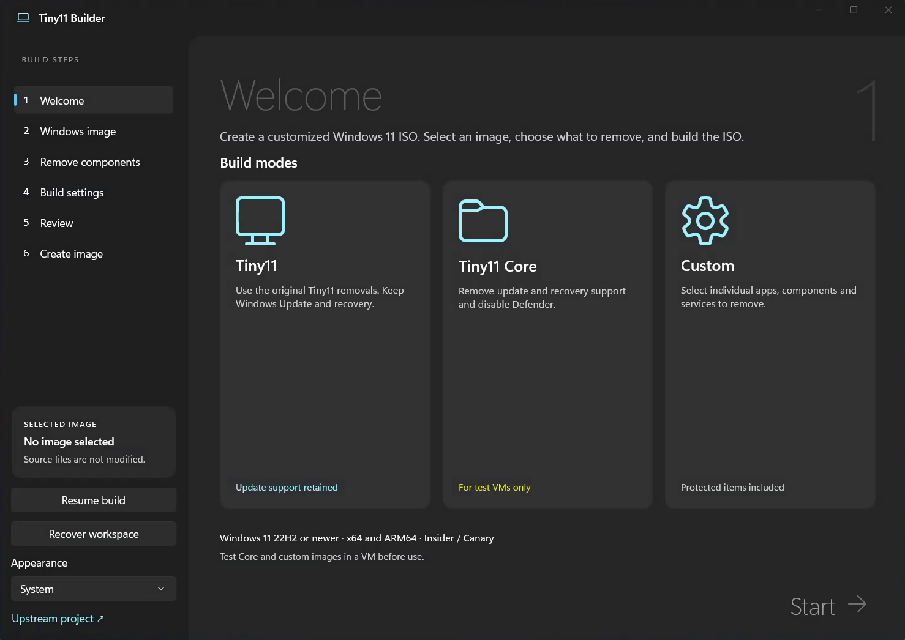
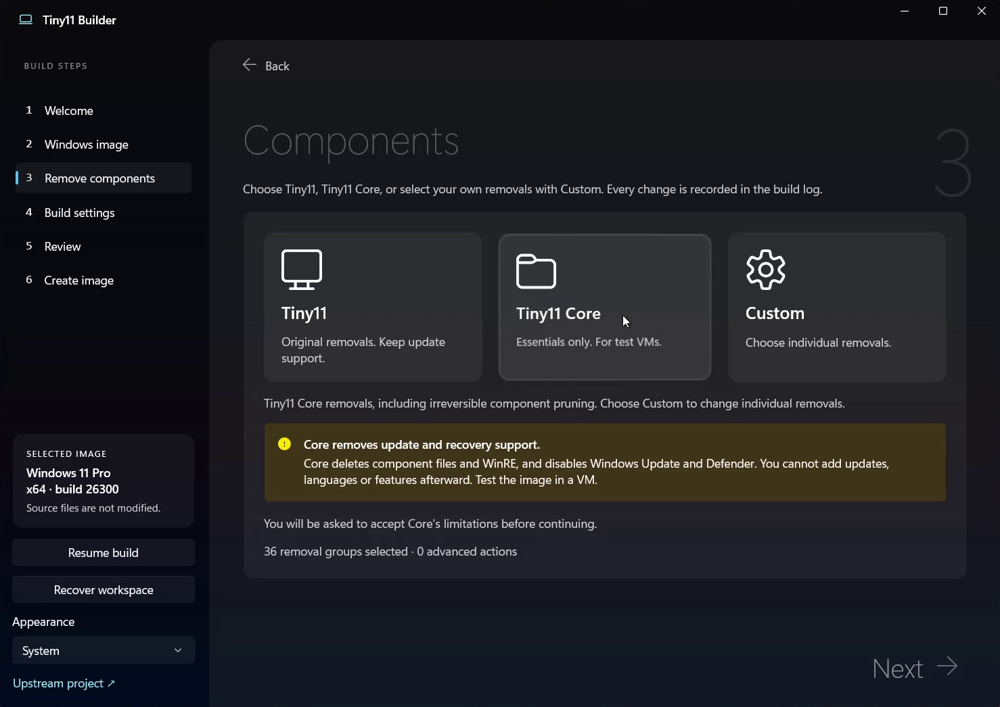
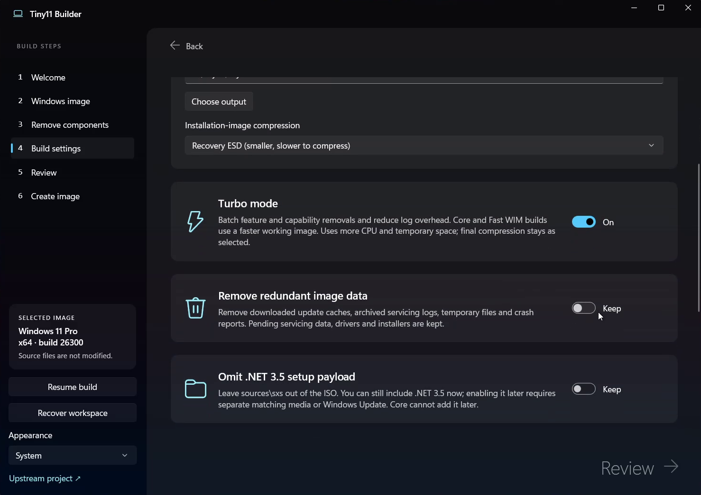

# Tiny11 Builder

This Is A Fork,Credit To Ntdev. Made With SI.

Build a streamlined, debloated Windows 11 ISO. Available as a native **WinUI 3** app for Windows and a complete **GTK 3** native desktop application for **Linux**, **macOS**, and **BSD** (FreeBSD, OpenBSD, NetBSD).

The portable GTK 3 edition runs without Windows or virtual machines, utilizing native POSIX tools (`wimlib-imagex` and `xorriso`) to export single-edition images, perform package and app purging, configure unattended installation (`autounattend.xml`), bypass hardware requirements (TPM 2.0, Secure Boot, RAM, CPU) in WinPE and setup, apply post-installation system debloat scripts (`SetupComplete.cmd`), and author bootable dual-mode BIOS/UEFI ISOs. Full documentation is available in [Portable edition guide](docs/portable.md).

## Download

[**Get the latest version**](https://github.com/ntdevlabs/tiny11builder/releases/latest)

Choose **x64** for Intel/AMD PCs or **ARM64** for Windows on ARM. Extract the
entire ZIP and open `Tiny11Builder.exe`. Administrator approval is required.

## Choose your build

| Mode | What it does |
| --- | --- |
| Tiny11 | Removes bundled apps and unwanted features while keeping updates, Defender and recovery. |
| Tiny11 Core | Trims further by removing servicing and recovery support and disabling Defender. |
| Custom | Choose individual apps, components, features and services to remove or keep. |

Turbo mode speeds up image processing. Interrupted builds can resume from saved
progress after the image is committed or compressed. Core and component-store
removals automatically use the legacy Windows installer.

**Core cannot be updated or serviced. Protected Custom removals can break
Windows. Test your ISO in a VM before installing it.**

## Video

[**Watch on YouTube**](https://youtu.be/LfEWIz5mQ8A)

## Screenshots

### Welcome

### Components

### Build settings

## More information

[Usage, compatibility and build instructions](docs/usage.md) ·
[Attribution and distribution notes](NOTICE.md)

The original PowerShell builders remain in this repository.

## Support the project

[GitHub Sponsors](https://github.com/sponsors/ntdevlabs) ·
[Patreon](https://www.patreon.com/ntdev) ·
[PayPal](https://paypal.me/ntdev2) ·
[Ko-fi](https://ko-fi.com/ntdev)
